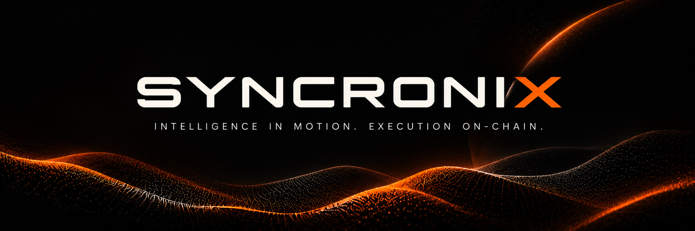
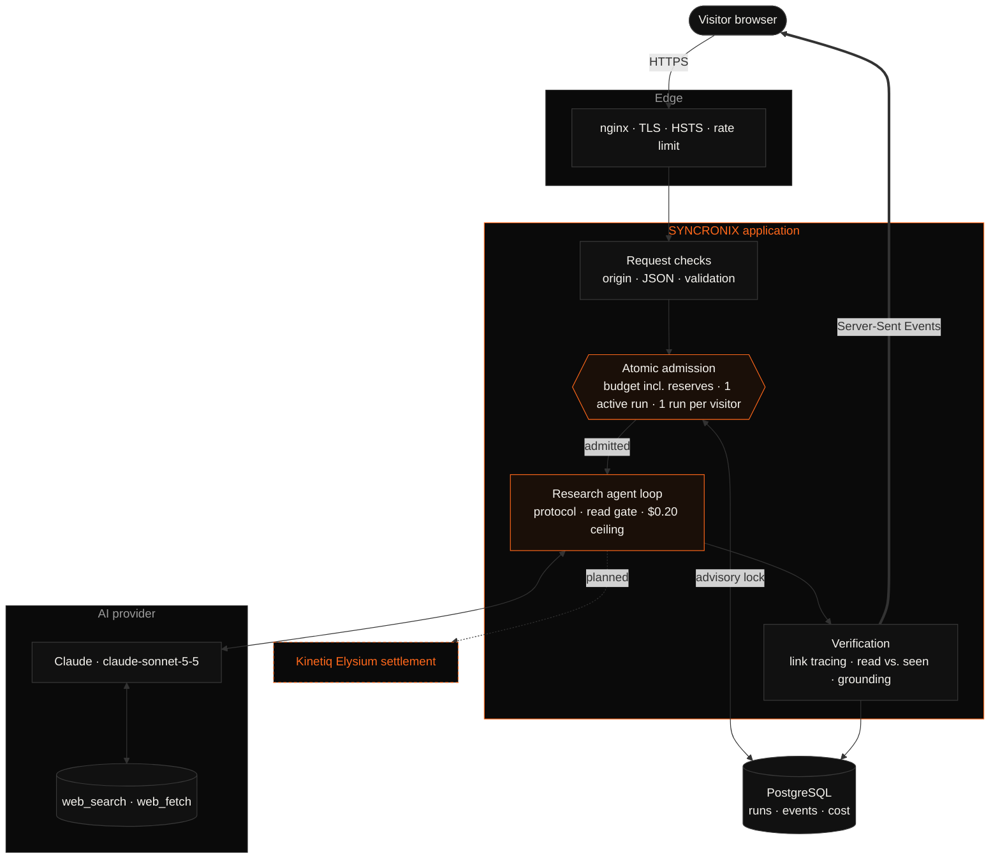
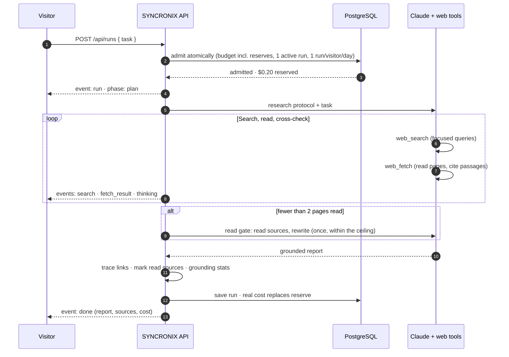
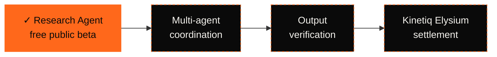

  

  <b>Infrastructure for autonomous AI agents</b> 
  Execution, coordination and verification, designed for Kinetiq Elysium.

  <a href="https://syncronixai.xyz"><b>Website</b></a>
  &nbsp;·&nbsp;
  <a href="https://syncronixai.xyz/platform#console"><b>Live console</b></a>
  &nbsp;·&nbsp;
  <a href="https://github.com/SyncronixLabs/syncronix-docs"><b>Docs</b></a>
  &nbsp;·&nbsp;
  <a href="https://x.com/SyncronixHq"><b>X / @SyncronixHq</b></a>

---

## Overview

SYNCRONIX is building infrastructure for autonomous AI agents: agents that take an objective, plan, act and
produce verifiable work. The first component in production is the **SYNCRONIX Research Agent**, a live web-research
agent that reads its sources, cross-checks them and delivers grounded reports. It is open to everyone as a
**free public beta**.

On-chain execution and settlement on **Kinetiq Elysium** is the next stage and is **not live yet**. Everything on
this page is labelled accordingly.

| | Status | What it means today |
|---|---|---|
| 🟠 **Research Agent** | **Live** — free public beta | Real web search, page reading, cross-checking, grounded reports, private history |
| ⚪ **Elysium settlement** | Planned | No wallet, no transactions. The console never signs or sends anything |
| ⚪ **Multi-agent coordination** | Planned | One agent per task today |
| ⚪ **Output verification beyond source tracing** | Planned | Today: every cited link is traced to a real search result or fetched page |

## What runs in production

<table>
<tr>
<td width="50%" valign="top">

**Grounded web research**
- Plans the task, searches the web, then **reads** the most relevant pages instead of relying on snippets
- Requires the official or primary source when one exists
- Cross-checks key claims across independent publishers; marks single-source claims
- Passage-level citations from fetched pages

</td>
<td width="50%" valign="top">

**Verifiable output**
- Every link in a report is traced to a real search result or fetched page; untraceable links are flagged
- Sources are labelled *read* vs. *seen*
- A grounding line per report: pages read, findings citing a read page, cited passages
- Live progress stream: plan → research → analyze → deliver

</td>
</tr>
<tr>
<td width="50%" valign="top">

**Cost discipline**
- Every run reserves a **$0.20** ceiling before it starts
- Shared **$0.50/day** budget, enforced atomically
- Measured cost of typical runs: **$0.04–$0.11**
- Your identical repeat within an hour is replayed at $0

</td>
<td width="50%" valign="top">

**Privacy by default**
- No account, no tracking script, no wallet
- History visible only to the browser that created it
- Visitor networks stored only as a keyed hash, never raw IPs
- Web content is treated as untrusted data by the agent

</td>
</tr>
</table>

## Public beta limits

| Limit | Value | Resets |
|---|---|---|
| Research runs per visitor (IPv4 address / IPv6 /64) | **1 per day** | 00:00 UTC |
| Runs in progress across the service | **1** | when the run finishes |
| Shared daily budget (model + search usage) | **$0.50** | 00:00 UTC |
| Cost ceiling per run | **$0.20** | — |

The console shows your remaining run and explains any limit with its reset time.
Details: [public beta](https://github.com/SyncronixLabs/syncronix-docs/blob/main/public-beta.md).

## System architecture

## Agent execution flow

## Security model

| Area | Control |
|---|---|
| Secrets | Server-side only, in a root-owned environment file; automated checks scan client bundles and responses |
| Budget abuse | Atomic admission with reservations; concurrency tests show no over-admission under simultaneous requests |
| Cross-site abuse | Same-origin requirement for starting runs; JSON-only bodies with a field allow-list |
| Private history | Random httpOnly owner token (hashed at rest); other visitors' runs return 404 |
| Prompt injection | Web content declared untrusted; the agent has no tools that act |
| Report rendering | Markdown without raw HTML; http(s) links only; `noopener` on external links |
| Transport | HTTPS + HSTS, Content-Security-Policy, X-Frame-Options DENY, request rate limiting |
| Recovery | Daily database backups (14 days); immutable releases with one-step rollback |

Full model: [security.md](https://github.com/SyncronixLabs/syncronix-docs/blob/main/security.md).

## Tech stack

| Layer | Technology |
|---|---|
| Agent | Claude (`claude-sonnet-5-5`) via the Anthropic SDK · Anthropic-hosted `web_search` / `web_fetch` · adaptive thinking · prompt caching |
| Application | Next.js 15.5 · React 19.1 · Node.js · Server-Sent Events |
| Interface | Tailwind CSS 3.4 · GSAP 3.13 · Lenis · Three.js |
| Data | PostgreSQL 16 (`pg`) · atomic admission under advisory locks |
| Operations | Ubuntu 24.04 · nginx · systemd · Let's Encrypt · daily `pg_dump` backups |
| Quality | Playwright-driven browser suite · axe-core accessibility audit · offline agent tests · security and concurrency suites |

## Repository ecosystem

| Repository | Purpose |
|---|---|
| 📘 [**syncronix-docs**](https://github.com/SyncronixLabs/syncronix-docs) | Architecture, research agent, public API, beta limits, security model, roadmap |
| 🔬 [**syncronix-research**](https://github.com/SyncronixLabs/syncronix-research) | Engineering notes with measurements: grounded web research, atomic budget admission |
| 📊 [**syncronix-benchmarks**](https://github.com/SyncronixLabs/syncronix-benchmarks) | Research-quality harness, metric definitions, measured results |
| 🧩 [**syncronix-examples**](https://github.com/SyncronixLabs/syncronix-examples) | Public API client and curl, plus a minimal grounded research agent |
| 🔒 syncronix-app | Production application (private) |

## Roadmap

Only the first stage is live. Items move to *live* when they run in production;
see the [roadmap](https://github.com/SyncronixLabs/syncronix-docs/blob/main/roadmap.md).

## Official links

| | |
|---|---|
| Website | [syncronixai.xyz](https://syncronixai.xyz) |
| Live console | [syncronixai.xyz/platform](https://syncronixai.xyz/platform#console) |
| X | [@SyncronixHq](https://x.com/SyncronixHq) |
| GitHub | [github.com/SyncronixLabs](https://github.com/SyncronixLabs) |

SYNCRONIX · Intelligence in Motion. Execution On-Chain.

