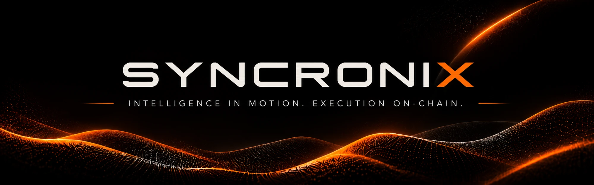
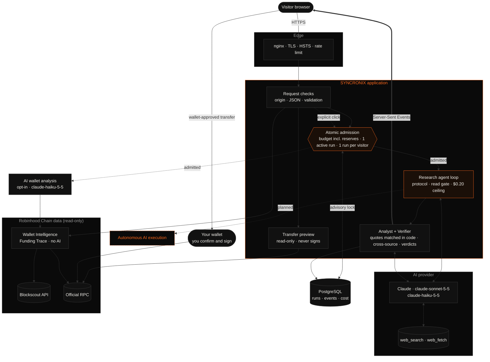
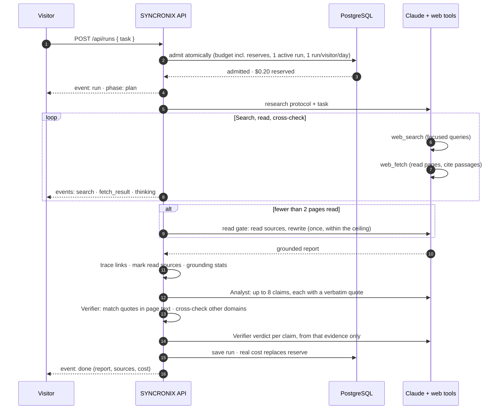

<p align="center">
  <a href="https://syncronixai.xyz">
    
  </a>
</p>

<p align="center">
  <b>Infrastructure for autonomous AI agents</b><br>
  Verified AI research, wallet intelligence and wallet-approved transfers for the Robinhood ecosystem.
</p>

<p align="center">
  <a href="https://syncronixai.xyz"><b>Website</b></a>
  &nbsp;·&nbsp;
  <a href="https://syncronixai.xyz/platform#console"><b>Live console</b></a>
  &nbsp;·&nbsp;
  <a href="https://github.com/SyncronixLabs/syncronix-docs"><b>Docs</b></a>
  &nbsp;·&nbsp;
  <a href="https://github.com/SyncronixLabs/syncronix-docs/blob/main/whitepaper.md"><b>Whitepaper</b></a>
  &nbsp;·&nbsp;
  <a href="https://github.com/SyncronixLabs/syncronix-docs/blob/main/getting-started.md"><b>Getting started</b></a>
  &nbsp;·&nbsp;
  <a href="https://x.com/SyncronixHq"><b>X / @SyncronixHq</b></a>
</p>

---

## $SNX contract address

The official $SNX token contract on **Robinhood Chain mainnet** (chain ID 4663), as shown on
[syncronixai.xyz](https://syncronixai.xyz):

```text
0x209f94e370c6870aea4c74240fe0cae7ef358059
```

Always compare the full address before you use it.

## Overview

SYNCRONIX is autonomous intelligence for the Robinhood ecosystem: agents that take an objective, research it, verify
the result and deliver work you can check. In production today, every run uses three agents (Researcher, Analyst and
Verifier) with live **Robinhood Chain** data. Any Robinhood Chain address can be looked up with **Wallet
Intelligence** and a **5-hop Funding Trace**, computed without AI; an **AI wallet analysis** runs only when you ask
for it. It is open to everyone, free.

**Wallet-approved transfers** are live on Robinhood Chain mainnet and verified there with a real transfer: one native
ETH transfer at a time that you preview, confirm and sign in your own wallet.
**Autonomous AI execution**, where agents would plan and carry out actions themselves, is the next stage and is **not live yet**. SYNCRONIX holds no keys and never signs.
Everything on this page is labelled accordingly.

| | Status | What it means today |
|---|---|---|
| 🟠 **Research Agent** | **Live** | Real web search, page reading, grounded reports, private history |
| 🟠 **Multi-agent coordination** | **Live** | Researcher, Analyst and Verifier on every run |
| 🟠 **Output verification** | **Live** | Every claim checked against the sources actually read and cross-checked across independent sources |
| 🟠 **Robinhood Chain data** | **Live** | Live network, address and transaction data in the console and in research |
| 🟠 **Wallet Intelligence** | **Live** | Transaction history, ETH inflows and outflows incl. internal transfers, contract interactions; Robinscan links |
| 🟠 **Funding Trace** | **Live** | First funder, funding timeline, up to 5 hops upstream, shared funders, interactive graph: verified vs. inferred |
| 🟠 **AI wallet analysis** | **Live, opt-in** | Runs only on an explicit click, after a cost estimate; inside the daily budgets |
| 🟠 **Wallet-approved transfers** | **Live, verified on mainnet** | Native ETH on mainnet and testnet; you preview, confirm and sign in your own wallet; no AI, no server keys |
| ⚪ **Autonomous AI execution** | Planned | Agents never sign; SYNCRONIX holds no keys |

## What runs in production

<table>
<tr>
<td width="50%" valign="top">

**Grounded web research**
- Plans the task, searches the web, then **reads** the most relevant pages instead of relying on snippets
- Requires the official or primary source when one exists
- Cross-checks key claims across independent publishers; marks single-source claims
- Passage-level citations from fetched pages

</td>
<td width="50%" valign="top">

**Verifiable output**
- Every link in a report is traced to a real search result or fetched page; untraceable links are flagged
- Sources are labelled *read* vs. *seen*
- A grounding line per report: pages read, findings citing a read page, cited passages
- Live progress stream: plan → research → analyze → deliver

</td>
</tr>
<tr>
<td width="50%" valign="top">

**Cost discipline**
- Every run reserves a **$0.20** ceiling before it starts
- Shared **$0.50/day** budget, enforced atomically
- Measured cost of typical runs: **$0.04–$0.11**
- Your identical repeat within an hour is replayed at $0

</td>
<td width="50%" valign="top">

**Privacy by default**
- No account, no tracking script; a wallet only to sign a transfer
- History visible only to the browser that created it
- Visitor networks stored only as a keyed hash, never raw IPs
- Web content is treated as untrusted data by the agent

</td>
</tr>
<tr>
<td width="50%" valign="top">

**Wallet Intelligence & Funding Trace**
- Indexed history (Blockscout API) cross-checked against the **official RPC**
- First funder marked *proven* only when the indexed history is complete
- Upstream path up to **5 hops**, each with a stated stop reason
- **Verified** transfers and **inferred** shared-funder links kept apart, never presented as ownership
- Every link goes to **Robinscan**; no AI involved

</td>
<td width="50%" valign="top">

**Opt-in AI wallet analysis**
- Estimated and maximum cost shown **before** anything runs
- One `claude-haiku-5-5` call, only after you click *Analyze with AI*
- Written from a fact sheet built in code; links not in it are removed
- Measured: **$0.0013–$0.0014** per brief
- Counts toward your daily run and the shared budget

</td>
</tr>
</table>

## Usage limits

| Limit | Value | Resets |
|---|---|---|
| Research runs per visitor (IPv4 address / IPv6 /64) | **1 per day** | 00:00 UTC |
| Runs in progress across the service | **1** | when the run finishes |
| Shared daily budget (model + search usage) | **$0.50** | 00:00 UTC |
| Cost ceiling per run | **$0.20** | — |
| Wallet lookups / funding traces per visitor (no AI) | **30 / 6 per minute** | rolling minute |
| AI wallet analysis | counts as your **1 daily run**; reserve of 2× its maximum cost | 00:00 UTC |

The console shows your remaining run and explains any limit with its reset time.
Details: [usage limits](https://github.com/SyncronixLabs/syncronix-docs/blob/main/limits.md).

## System architecture



## Agent execution flow



## Security model

| Area | Control |
|---|---|
| Secrets | Server-side only, in a root-owned environment file; automated checks scan client bundles and responses |
| Budget abuse | Atomic admission with reservations; concurrency tests show no over-admission under simultaneous requests |
| Cross-site abuse | `POST` endpoints accept only the site's own origin and no CORS headers are sent, so other websites cannot call the API from a browser (terminals and servers can); JSON-only bodies with a field allow-list |
| Private history | Random httpOnly owner token (hashed at rest); other visitors' runs return 404 |
| Prompt injection | Web content declared untrusted; the agent has no tools that act |
| Report rendering | Markdown without raw HTML; http(s) links only; `noopener` on external links |
| Indexer key | Server-side only; fixed path allowlist, per-lookup call budgets, daily allowance and credit floor |
| AI spend on wallets | No model call without an explicit click; estimate first; same atomic admission as research runs |
| Wallet transfers | Signed only in the user's wallet after an explicit confirmation; no server keys; mainnet capped at 0.05 ETH |
| Transport | HTTPS + HSTS, Content-Security-Policy, X-Frame-Options DENY, request rate limiting |
| Recovery | Daily database backups (14 days); immutable releases with one-step rollback |
| Reporting | Private vulnerability reports through GitHub: [SECURITY.md](SECURITY.md) |

Full model: [security.md](https://github.com/SyncronixLabs/syncronix-docs/blob/main/security.md).

## Tech stack

| Layer | Technology |
|---|---|
| Agents | Claude via the Anthropic SDK: Researcher `claude-sonnet-5-5`, Analyst and Verifier `claude-haiku-5-5` · Anthropic-hosted `web_search` / `web_fetch` · adaptive thinking · prompt caching |
| Application | Next.js 15.5 · React 19.1 · Node.js · Server-Sent Events |
| Interface | Tailwind CSS 3.4 · GSAP 3.13 · Lenis · Three.js |
| Data | PostgreSQL 16 (`pg`) · atomic admission under advisory locks |
| Chain data | Robinhood Chain official RPC (read-only) · Blockscout API for indexed history · Robinscan for links · `claude-haiku-5-5` for opt-in wallet briefs |
| Operations | Ubuntu 24.04 · nginx · systemd · Let's Encrypt · daily `pg_dump` backups |
| Quality | Playwright-driven browser suite · axe-core accessibility audit · offline agent tests · security and concurrency suites |

## Repository ecosystem

| Repository | Purpose |
|---|---|
| 📘 [**syncronix-docs**](https://github.com/SyncronixLabs/syncronix-docs) | [Whitepaper](https://github.com/SyncronixLabs/syncronix-docs/blob/main/whitepaper.md), [getting started](https://github.com/SyncronixLabs/syncronix-docs/blob/main/getting-started.md), architecture, research agent, Wallet Intelligence, wallet transfers, public API, limits, security, roadmap, [changelog](https://github.com/SyncronixLabs/syncronix-docs/blob/main/CHANGELOG.md) |
| 🔬 [**syncronix-research**](https://github.com/SyncronixLabs/syncronix-research) | Engineering notes with measurements: grounded web research, atomic budget admission, proving a wallet's first funder, fee headroom for a 60 s transfer preview |
| 📊 [**syncronix-benchmarks**](https://github.com/SyncronixLabs/syncronix-benchmarks) | Research-quality, Wallet Intelligence, API conformance and fee-headroom harnesses, metric definitions, measured results |
| 🧩 [**syncronix-examples**](https://github.com/SyncronixLabs/syncronix-examples) | Public API client and curl, a Wallet Intelligence client, a read-only transfer preview and receipt checker, plus a minimal grounded research agent |
| 🔒 syncronix-app | Production application (private) |

## Verified milestones

| Date (UTC) | Milestone | Verified by |
|---|---|---|
| 2026-11-13 | Research Agent live, free, with a hard daily budget | Production runs; concurrency tests on real PostgreSQL |
| 2026-11-17 | Researcher, Analyst and Verifier on every run; Robinhood Chain reads | Verifier results in every production run; chain ID checked on each read |
| 2026-11-19 | Wallet Intelligence and Funding Trace | Production measurement: newest transaction matched the official RPC 5/5 |
| 2026-11-20 | Wallet-approved transfers, testnet then mainnet | Real wallet-signed transfers read back from the official RPC, sent exactly as previewed |

Details and evidence: [verified milestones](https://github.com/SyncronixLabs/syncronix-docs/blob/main/roadmap.md#verified-milestones) ·
[changelog](https://github.com/SyncronixLabs/syncronix-docs/blob/main/CHANGELOG.md).

## Roadmap


The first six stages are live; autonomous AI execution is next. Items move to *live* when they run in production;
see the [roadmap](https://github.com/SyncronixLabs/syncronix-docs/blob/main/roadmap.md).

## Official links

| | |
|---|---|
| Website | [syncronixai.xyz](https://syncronixai.xyz) |
| Live console | [syncronixai.xyz/platform](https://syncronixai.xyz/platform#console) |
| X | [@SyncronixHq](https://x.com/SyncronixHq) |
| GitHub | [github.com/SyncronixLabs](https://github.com/SyncronixLabs) |

<p align="center"><sub>SYNCRONIX · Intelligence in Motion. Execution On-Chain.</sub></p>

<p align="center"><sub>SYNCRONIX is an independent project and is not affiliated with, endorsed by or partnered with Robinhood Markets, Inc. or its affiliates. Robinhood and Robinhood Chain are trademarks of their respective owners.</sub></p>
